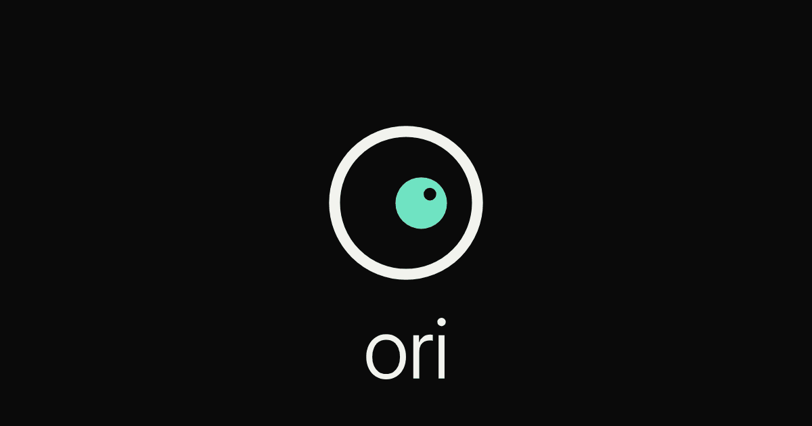

# ORI — One Balance



> ⚠️ **Not payment-ready.** ORI is a hackathon prototype. No real payment, swap, or wallet signature has been verified end to end on mainnet. Spending limits are browser-side only (not on-chain). Do not use it with funds you are not prepared to lose. Production can ask a **connected** wallet to sign real transfers; ORI does **not** create custodial wallets yet.

**Live preview:** https://ori-preview.vercel.app/ (production deployment of commit `6bf4ff8`, built with `VITE_ORI_SETTLEMENT_MODE=live`)

> ⚠️ **The production site is not a simulation.** It was built with the **live** settlement flag.
> - **Direct Send** (same-chain ETH/USDC/SOL/SPL) asks your **real wallet** to sign a **real transfer**.
> - **Live Pay and Swap** request real quotes and deposits. The Node/Web runtime adapter is fixed; endpoints respond. Real mainnet signing and settlement are still **not** end-to-end verified, so do not treat cross-chain Pay/Swap as ready.
> - Only connect a wallet and sign if you mean to move real funds. No funds have been moved by the team.

---

## Vision

ORI gives you **one balance for all your money** across Ethereum, Base, Solana and NEAR. You can send, receive, pay or swap from that one view. When money has to cross chains, ORI uses **NEAR Intents** (the 1Click API). When it stays on one chain, ORI makes an ordinary transfer from your own wallet with no detour. ORI never holds your keys, adds no app fee, and shows you exactly what your wallet will sign before it signs.

It is being built for the NEAR hackathon (build window 1–14 Nov 2026). Product requirements live in [CORE_REQUIREMENTS.md](CORE_REQUIREMENTS.md), status and blockers in [HANDOVER.md](HANDOVER.md), and the architecture plan in [PLAN.md](PLAN.md).

---

## Contents
- [Status at a glance](#status-at-a-glance)
- [Features](#features)
- [Support matrix](#support-matrix)
- [How signing and review work](#how-signing-and-review-work)
- [Architecture](#architecture)
- [Repository layout](#repository-layout)
- [Getting started](#getting-started)
- [Environment variables](#environment-variables)
- [Testing](#testing)
- [Deployment](#deployment)
- [Known limitations](#known-limitations)
- [Troubleshooting](#troubleshooting)
- [Roadmap](#roadmap)

---

## Mainline branch (`ori-mainline`, Nov 12 2026)

`ori-mainline` is the consolidated working branch for the NEAR hackathon. It starts from `native-wallets-mainnet` and brings in the Nov 8 `fix/guest-mainnet-auth-transfer` work by hand:

- **Guest vs registered separation.** Guests get example data and **DEMO-only Pay** (labelled *GUEST DEMO · NO CHAIN TRANSACTION*; no wallet, no deposit, logged as DEMO). A session is **registered** once there is a Gmail account or an ORI wallet on the device: it is locked to live mainnet data, DEMO activity is hidden from History, Profile shows only real addresses, and Pay never falls back to a simulated success (example handles and a deployment without settlement are **blocked** with "No funds were moved").
- **Receipts.** Base sends report *confirmed / failed / pending* from the on-chain receipt (`sendEvm` polling), never success on broadcast alone.
- **Durable email-code store.** `api/auth/_store.ts` supports Upstash Redis REST (`UPSTASH_REDIS_REST_URL`, `UPSTASH_REDIS_REST_TOKEN`). Without both, Gmail codes still fail closed (503).
- **Vercel Node handlers.** Kept the `api/_runtime.ts` `adapt()` Node↔Web adapter (exact body bytes, tested) instead of the Nov 8 `_http.ts` helpers.
- **Startup.** A visible error boundary replaces blank frames; the intro starts on the wordmark.
- **ORI wallets are receive-only.** No NEAR signing relayer is funded, so ORI-created wallets can receive on NEAR, Base, Ethereum and Solana but cannot send; the UI says so on Receive, Send, Profile and Help. Use a connected wallet (MetaMask, Phantom) to send.
- Dropped: the `native-wallet-vault` (password vault) approach. That branch is left untouched.

## Status at a glance

| Area | State |
|---|---|
| Frontend UI (Home, Send, Receive, Swap, Pay, History, Policy, Account) | Deployed and browser-checked on desktop by the team; **phone / iPhone speech not verified** |
| Public 1Click token list and dry-run quotes from the browser | Working on the deployment (215 tokens on Nov 5) |
| Native same-chain Send / Receive (connected wallets) | Implemented for supported assets; **active on production** for already-connected/imported wallets; mock-tested only — not verified with a real mainnet signature by the team |
| ORI-created native wallets (passkey + email recovery) | **Built on branch `native-wallets-mainnet` (preview only).** NEAR Auth mainnet login → MPC-derived NEAR implicit account + Chain Signatures addresses (EVM `ethereum-1` for Base/Ethereum, Solana `solana-1`), shown on Receive with Copy. NEAR send signs through NEAR Auth but is **disabled until a signing relayer exists** (`VITE_ORI_NEAR_RELAYER_URL`). Sending from the EVM/Solana addresses is **not wired**. First real login is **blocked**: no ORI URL is on the NEAR Auth app's allowed callback list yet |
| Live cross-chain Pay and Swap (`/api/quote` + `/api/status`) | Runtime adapter fixed at `6bf4ff8`. Public checks: `/api/resolve` for `@tolu` → 404 (not a registered recipient); `/api/status` without `depositAddress` → 400; `/api/quote` GET → 405. Code + mocks exist; **real mainnet settlement not end-to-end verified** |
| Demo Pay `@tolu` | Explicit **EXAMPLE · SIMULATED** receipt/history path only — no funds, not a registered live recipient |
| Gmail code registration/login | **Not functional** (fail-closed 503): durable store, signed session and mail provisioning still missing |
| NEAR Auth (production) | **Approved** 6 Nov 2026 (client `b6UA35Hea4utXEzCwwoTPnyikGiqwyiq`, domain `login.auth.near.org`). On 9 Nov 2026 Auth0 still returned *Callback URL mismatch* for `https://ori-preview.vercel.app`, preview URLs and localhost, so the allowed callback/web-origin URLs must be added by NEAR Auth before anyone can sign in |
| Spending limits | Enforced only inside the ORI browser app (no on-chain or backend enforcement) |
| NEAR as a send origin | Quote-only today — no NEAR signing from ORI |

**Two modes, don't confuse them.**
- **Production (https://ori-preview.vercel.app/) is built with `VITE_ORI_SETTLEMENT_MODE=live`.** Pay and Swap reviews are labelled **"LIVE · YOUR WALLET SIGNS"** and call `/api/quote`. The Node/Web runtime adapter is fixed; real mainnet signing/settlement is still not end-to-end verified. Direct Send never depends on this flag: it always uses a **connected** real wallet (ORI does not create one).
- **Local builds default to example mode** (`.env.example` sets `preview`). Pay and Swap confirmations are then simulations labelled **"EXAMPLE · SIMULATED"**, and nothing is signed. Direct Send still uses a real wallet if you connect one.

---

## Features

### Home
- One total balance and per-asset rows. Each asset has **Send** and **Receive** actions (mobile rows and a desktop table).
- Numbers are **example data** (`app/src/mock.ts`) unless you add a real or watched address. Prices come live from the public 1Click token list.
- The former "Pay" tile is now **Receive**. A **profile control** (profile, account, log out) replaces the EVM address shown above the portfolio.

### Receive
- Always lists **Base, Ethereum, Solana and NEAR**. A row shows a connected or watch-only address you can copy, or **Not connected** / **No address added** (those cannot be copied).
- ORI never invents addresses or keys. **Watch-only** means you pasted a public address; ORI does not verify that you own it, and it cannot sign or move anything from it.
- The same EVM address can appear on both Base and Ethereum; send the matching asset on the network you pick.
- You can connect a wallet on the existing Wallets screen or add an existing address, including a NEAR account. Receiving to NEAR works; sending from ORI on NEAR is not available yet.
- Copy one row, or copy only the populated addresses. See your **preferred receiving currency**.

### Send (same-chain, direct)
- Paste or type a recipient. Validation knows each network's address format.
- Choose asset and network, see a fee estimate read from the chain's RPC, review, then authorize in your wallet.
- Status is tracked by the receipt or signature, and the result goes into History.
- Same-chain sends **never** go through NEAR Intents. SOL → a Solana wallet is a normal Solana transaction; EVM → EVM is a normal transfer.
- Right before signing, ORI re-checks your balance, the fee and your limits.

### Swap (cross-chain via NEAR Intents)
- The pickers list **every token in the live 1Click catalog**. A big catalog is not the same as support, though: a token can only be the **source** of an executable swap when ORI has a signer for it (see the matrix). Anything else is labelled **"quote only"**.
- **Quote only** means ORI shows you the provider's live price, fee and settlement time, but it cannot sign a deposit from that asset. The button stays disabled, and nothing is ever simulated as a success.
- Same asset on the same chain shows *"use Send (direct transfer)"*.
- Settlement time comes from the quote's `timeEstimate` (seconds after the deposit confirms). If it is missing, the app says *"Time unavailable"*. Quotes refresh every 30 s, and the newest request always wins.

### Pay
- Pay a Solana address or a handle (handles come from the server-only `ORI_HANDLE_DIRECTORY` allowlist), or pay a Base address directly.
- A Solana recipient goes USDC on Base → USDC on Solana via NEAR Intents. A Base address gets a direct USDC transfer on Base.

### Hey ORI
- Tap or click **Hey ORI** to open chat and, where the browser supports it, start speech recognition for that gesture only. There is **no always-on wake word** (nothing like Hey Siri). A second tap, Stop, Close, or leaving the screen ends listening. Recognition does not restart itself.
- What you say is transcribed into the chat box for you to send or clear. Understanding goes through the existing local chat assistant (not an AI model), which still asks before any payment or swap. ORI will not sign or spend from a voice command alone.
- Spoken replies stay **opt-in** (Settings → Ori speaks replies).
- Support varies by browser. iOS Safari in particular is limited, and speech input was not verified on a physical iPhone; you can always type.
- A static check enforces user-initiated listening only: `npm run check:activation`.

### Security Center / Policy
- You can set limits for a single payment and per day, plus an approval threshold where you have to slide to confirm.
- Limits **fail closed**: a missing, corrupt or tampered value blocks the action.
- **What enforces them:** the ORI browser app, and nothing else. They are checked on the cards and again right before signing. They live in `localStorage`. Anyone who controls the browser can clear them, and a wallet used outside ORI is not governed at all. ORI makes **no** on-chain, NEAR contract, Chain Signatures or TEE enforcement claims.

### Account
- **Guest mode** always works. Profiles are **device-local**.
- Log out keeps the profile on the device (`ori-known-profiles`) and does not touch wallets.
- Gmail code registration and login are built but **not functional yet** (see Known limitations).

### Hidden for the submission
`HIDDEN_SCREENS = ['scan', 'earn', 'privacy']` in `app/src/config.ts`.

---

### UI micro-interactions (original ORI code, Nov 5)
These are UI only. None of them changes signing, limits, the review sheet or the wallet's own approval.

- **Slide to confirm.** On the cards, a tap only opens the review sheet. Above the approval threshold, the review sheet replaces hold-to-confirm with a slide: the handle must travel all the way while held, and letting go early or a pointer cancel resets it. It is disabled while the action is blocked and fires once only. Keyboard and screen-reader users press Enter (or Space), release it, then press again. Holding the key or auto-repeat never confirms, and Esc or a 5 s timeout disarms it. Below the threshold, the sheet is a single tap. The wallet still asks separately: this is a UI gesture, not a security control.
- **Copy buttons** show a check only when the browser confirms the clipboard write. Otherwise they say "Copy failed".
- **Hidden balance** blurs amounts on tap (restored to the pre–digit-mask interaction). Tap again to show.
- **Live quote numbers:** changed digits ease in (price flow). The values are never altered and get no gain/loss colouring.
- **Searchable token picker** on Swap: type to filter the catalog; held/spendable assets rise to the top; amount is capped to available balance (native gas reserved). Quote-only origins stay labelled and are not signable.
- **@tolu / @ade handles:** resolve for dry quotes as EXAMPLE destinations (same preview Solana address used elsewhere). Live pay still needs a verified `ORI_HANDLE_DIRECTORY` entry — ORI will not invent a real payee.
- **Settlement times (~22s, ~37s, etc.):** the UI formats the provider’s `quote.timeEstimate` when a **fresh quote for the current route** is present. That field is an estimate of seconds after deposit confirms — not quote latency, not a guarantee, and **not proof the on-screen number is fresh**. ORI does not hardcode 22 or 37. Dry public samples (Africa/Lagos 2026-11-05 23:57) returned distinct raw values per route (SOL→Base USDC 22, Base USDC→Solana USDC 32, Base USDC→SOL 34, ETH→SOL 42, SOL→ETH 27). If the public quote call fails, ORI cannot verify an ETA. The badge is **PROVIDER QUOTE** (or STALE / REFRESHING), never a LIVE settlement claim; changing route clears the previous ETA immediately.
- **Tabs and segments:** the Tokens/Chains tabs and the Settings segments share one spring tab control, with arrow-key support.
- **Dropdowns:** styled history and token pickers. The send-asset picker groups tokens by chain and shows a "QUOTE ONLY" chip for sources ORI can't sign.
- **Gmail code:** a single 6-digit field that handles paste and autofill. The separate 4-digit recovery PIN is labelled as device-only. Gmail login itself is still not functional (503).
- **Send form errors** are announced (`role="alert"`), mark the field invalid and shake once.
- **Hey ORI:** tap-to-talk shows decorative listening bars. They are not a microphone level, and there is no wake word.
- **Chat composer:** labelled as a local rule-based assistant, not an AI model.

Reduced motion is respected throughout (`MotionConfig reducedMotion="user"` plus CSS media queries). The logic is unit-tested in `app/tests/ui.test.ts`; the visual and touch behaviour has not been checked in a browser or on a phone yet.

## Support matrix

**Direct Send (same chain, signed in your wallet)**

| Asset | Network | Signer | Notes |
|---|---|---|---|
| ETH | Ethereum, Base | EIP-1193 wallet (e.g. MetaMask) | native value transfer |
| USDC | Ethereum (`0xa0b8…eb48`), Base (`0x8335…2913`) | EIP-1193 | ERC-20 `transfer`, 6 decimals |
| SOL | Solana | Phantom `signAndSendTransaction` | System Program transfer; recipient must stay rent-exempt |
| USDC (`EPjF…Dt1v`), USDT (`Es9v…NYB`) | Solana | Phantom | SPL `transferChecked` with pinned mint and 6 decimals |
| NEAR, other SPL tokens, other EVM chains | — | none | shown **disabled**, never simulated |

**Swap / Pay sources ORI can sign a deposit from:** ETH and ERC-20 tokens on Ethereum and Base, native SOL, and USDC/USDT on Solana (only the pinned mints, and only when the catalog's symbol and decimals match).

**Destinations:** any catalog asset on a chain whose address format ORI can validate. For live swaps, the recipient must be **your own** connected wallet on that chain. Everything else is quote-only.

**Fees**
- ORI adds **no app fee** (`appFees` is never set) and invents no gas targets.
- The network fee comes from the chain's RPC (gas × gas price, or Solana `getFeeForMessage`). The provider's fee or spread is shown separately.
- A Solana token send to a recipient with no token account for that coin also pays that account's **rent** (`getMinimumBalanceForRentExemption(165)`, about 0.002 SOL). It is shown in review, and the account is created idempotently only when it is missing.
- ORI **never** requests token approvals. Every deposit is a single direct transfer.

---

## How signing and review work

Only in live mode (`VITE_ORI_SETTLEMENT_MODE=live`, plus a working server API):

1. **Review builds one plan.** The server fetches a fresh non-dry quote. Your own source wallet is the refund address; for swaps, your own destination wallet is the recipient. The review sheet is labelled **"LIVE · YOUR WALLET SIGNS"** and shows the route, from-account, deposit address, recipient, refund address, minimum received, provider fees, quote expiry and "Approvals: None".
2. **The quote is bound to that review** (`checkSwapQuote` in `app/src/swapExec.ts`). It must have:
   - the exact origin and destination asset IDs, amount, recipient and refund address;
   - a minimum output at or above the reviewed floor;
   - a deadline more than 30 s away (a missing deadline is rejected);
   - no memo;
   - a deposit address in the source chain's format.

   Any mismatch stops the flow before your wallet is asked anything.
3. **Signing-time checks.** Limits are checked again. EVM wallets are switched to the right chain, the chain id is re-read, and the account must match. Then exactly one direct deposit is signed.
4. **Confirmation.**
   - EVM sends are confirmed by receipt: only `0x1` counts as confirmed, `0x0` is failed, and no receipt yet means pending.
   - Solana sends are confirmed by signature status.
   - Cross-chain swaps and payments are then polled through `/api/status`.
5. **History** marks a cross-chain transfer *completed* only when the provider reports `SUCCESS`. `REFUNDED`, `FAILED` and pending keep their own states. If you refuse in your wallet, the entry is marked *cancelled* and nothing was sent.
6. **Daily spend holds.** A live payment reserves its amount once the deposit is broadcast. It is released exactly once if the transfer is refunded or fails, without touching other spends.

In example mode (the local default), Pay and Swap run a labelled simulation and nothing is signed for them. Direct Send is never simulated in either mode.

---

## Architecture

```
Browser (React 19 + Vite + TS)
 ├─ public reads: 1Click /v0/tokens + dry quotes, public RPCs (Ethereum, Base, Solana, NEAR), GoPlus address checks
 ├─ wallets: EIP-1193 (window.ethereum), Phantom (window.solana) — the user signs; ORI never holds keys
 └─ /api/* (Vercel functions, server-only secrets)
     ├─ quote.ts    → 1Click /quote (dry:false), route validated against the trusted catalog (_catalog.ts)
     ├─ status.ts   → 1Click /status
     ├─ resolve.ts  → @handle → verified Solana address (ORI_HANDLE_DIRECTORY)
     └─ auth/       → send-code / verify-code (Gmail OAuth2 mail, AuthStore)
```
Boundaries:
- The 1Click JWT stays on the server.
- The server validates every quote against the trusted token catalog (cached for 5 min) and per-chain address formats.
- Without `ORI_1CLICK_JWT` the API returns 503 on purpose: there is no unauthenticated fallback, because that costs an extra 0.25%.

Key modules in `app/src/`:

| File | Role |
|---|---|
| `transfers.ts` | assets, address validation, exact BigInt units, fee estimates, `sendEvm` / `sendSol` / `sendSpl` |
| `swapExec.ts` | quote binding (`checkSwapQuote`), status mapping, `executeSwap` |
| `payExec.ts` | Pay plan (`preparePay`) and execution (`executePay`) |
| `live.ts` | token list, quotes, wallet connect, portfolio reads |
| `limits.ts` / `settings.ts` | fail-closed limits, local spend ledger and holds |
| `quoteTime.ts` | settlement-time parsing and display |
| `Send.tsx`, `Receive.tsx`, `App.tsx`, `Policy.tsx`, `Account.tsx` | screens |

---

## Repository layout

```
.
├── README.md, HANDOVER.md, CORE_REQUIREMENTS.md, PLAN.md, TODO.md, TOKEN_LOGO_SOURCES.md
├── brand/      logo, icons, OG image
├── mascot/     Ori mascot concepts
├── shots/      QA screenshots from earlier iterations (may not match the current UI)
└── app/
    ├── src/        React app (see table above)
    ├── api/        Vercel functions: quote, status, resolve, auth/*, _catalog, _oneclick
    ├── tests/      node:test suites + register.mjs loader + fixture-tokens.json
    ├── scripts/    check-click-activation.mjs (static checks)
    ├── public/
    ├── .env.example
    └── package.json, vite.config.ts, tsconfig*.json
```

---

## Getting started

**Prerequisites:** Node **24** (tests rely on Node's built-in TypeScript type stripping; verified on v24.22) and npm.

```bash
cd app
npm install
npm run dev        # Vite dev server, http://localhost:5173
npm run build      # tsc -b && vite build  → app/dist
npm run preview    # serve app/dist
npm run lint       # oxlint
npm test           # node tests + static checks
npm run check:activation
```

**Frontend only vs. real API.** `npm run dev` and `npm run preview` serve **only the frontend**; Vite does not host `app/api/*`. Example mode (if built without `live`) and the browser's public reads and dry quotes work fine like this, but `/api/*` calls fail locally. To exercise the functions you need a Vercel-style runtime (for example `vercel dev` in a linked project) **and** the server variables below. Note the [runtime limitation](#known-limitations) before relying on it.

Handy URL: `?screen=home|pay|swap|send|receive` opens a screen directly.

---

## Environment variables

Names only. **Never commit values.** Copy `app/.env.example` for local use and set the real values as Vercel environment variables.

| Name | Where | Used by | Purpose |
|---|---|---|---|
| `VITE_ORI_SETTLEMENT_MODE` | browser (build time) | `src/live.ts` | `live` enables real settlement flows; anything else (default `preview`) = example mode |
| `ORI_1CLICK_JWT` | server | `api/_oneclick.ts` | 1Click API key; missing → `/api/quote` and `/api/status` return 503 |
| `ORI_HANDLE_DIRECTORY` | server | `api/resolve.ts` | JSON allowlist of `@handle` → verified Solana address |
| `GMAIL_OAUTH_USER` | server | `api/auth/send-code.ts` | Gmail sender account |
| `GMAIL_OAUTH_FROM` | server | `api/auth/send-code.ts` | From header (defaults to the user) |
| `GOOGLE_OAUTH_CLIENT_ID` | server | `api/auth/send-code.ts` | OAuth2 client |
| `GOOGLE_OAUTH_CLIENT_SECRET` | server | `api/auth/send-code.ts` | OAuth2 client secret |
| `GMAIL_OAUTH_REFRESH_TOKEN` | server | `api/auth/send-code.ts` | OAuth2 refresh token |
| `ORI_AUTH_CODE_SECRET` | server | `api/auth/*` | secret used to hash and verify one-time codes |
| `UPSTASH_REDIS_REST_URL` | server | `api/auth/_store.ts` | Upstash Redis REST endpoint for one-time codes and rate limits (https only) |
| `UPSTASH_REDIS_REST_TOKEN` | server | `api/auth/_store.ts` | Upstash REST token; missing → email codes fail closed |
| `VITE_ORI_NEAR_RELAYER_URL` | browser (build time) | `src/oriWallet.ts` | optional NEAR signing relayer; unset → ORI wallets are receive-only |

Never prefix a server variable with `VITE_`; that would ship it to the browser.

---

## Testing

```bash
cd app && npm test
# = node --import ./tests/register.mjs --test tests/*.test.ts && node scripts/check-click-activation.mjs
```
Use the prescribed loader (`tests/register.mjs` resolves the `.js` import specifiers used in `api/`). Don't run `node --test` raw.

Currently: **90 node tests and 31 static checks pass**. They cover:
- limits;
- quote time;
- Receive targets;
- transfers: validation, units, fees, chain/account re-checks, receipts, rent;
- the token catalog and route validation;
- auth (fail-closed, one-time codes, rate limits) with an in-memory store;
- swap binding and status;
- SPL: instructions, rent and refusal;
- Pay: binding, wrong chain or account, refusal, refunds and spend holds, failed receipts;
- Swap UI state.

**What the tests do not prove:** everything above runs with **mocked** wallets, RPCs and provider responses. No real transfer, signature, 1Click non-dry quote or status response, mail delivery, or phone/mobile check has been done.

---

## Deployment

- The existing Vercel project **`ori-preview`** (root directory `app`) serves https://ori-preview.vercel.app/. That is currently `6bf4ff8`, built with `VITE_ORI_SETTLEMENT_MODE=live`. The Node/Web runtime adapter (relative URL + exact Buffer body copy) is in this commit. Direct Send can request signatures from a **connected** wallet; real mainnet settlement is still not end-to-end verified.
- Guardrails:
  - Deploy only to that project.
  - Production already has `VITE_ORI_SETTLEMENT_MODE=live`. Don't attempt real cross-chain payments until the owner approves a controlled recipient and wallet test.
  - Keep every secret in Vercel environment variables.
  - Don't remove the JWT guard without the owner's fee decision.
  - Only the owner decides when the repo goes public.
  - NEAR Auth approval (when it arrives) does not by itself ship ORI-created wallets — custody/signer/recovery/gas still have to be built.

---

## Known limitations

1. **Node/Web runtime adapter — fixed at `6bf4ff8`.** Handlers use a shared `adapt()` wrapper (`app/api/_runtime.ts`) so Node `(req, res)` and Web `Request` both work: absolute URL construction for relative paths, and exact Buffer body bytes (no pooled `ArrayBuffer` leak). Prior unit coverage included runtime/body regressions; earlier suite reported **138 unit + 31 activation** checks passing (not re-run for this docs update). Public smoke previously seen: `/api/resolve?handle=tolu` → 404; `/api/status` without `depositAddress` → 400; `/api/quote` GET → 405.
2. **Not payment-ready / not security-on-chain.** No real mainnet payment, swap or wallet signature has been verified end to end. Spending limits are browser-side only.
3. **ORI does not create wallets yet.** Native Send/Receive work only with wallets the user already connects or imports. Desired product direction is ORI-created wallets with passkey + email recovery; custody, signer, recovery and gas for that path are **unimplemented**. NEAR Auth production access is **pending** (see Status at a glance); approval alone does not implement those features.
4. **Provider timeouts.** On Nov 5, 1Click dry quotes sometimes timed out on the provider's side. No real non-dry quote or live settlement response has been fully traced end to end.
5. **Gmail login is not functional.** It needs:
   - a durable `AuthStore` (`app/api/auth/_store.ts`; `getAuthStore()` returns null today) with atomic rate limits and one-time code consumption, e.g. Redis/KV;
   - a signed server session;
   - the Gmail OAuth / mail provisioning variables.

   None are configured, so the endpoints return **503**. Profiles are device-local, with no cross-device restore.
6. **Limits are browser-only.** See Security Center above.
7. **No NEAR signing from ORI.** NEAR can appear as quote-only; there is no ORI NEAR send path and no Chain Signatures.
8. **Mobile / iPhone speech has not been verified.**

---

## Troubleshooting

| Symptom | Likely cause |
|---|---|
| Swap shows "Live quote unavailable" | 1Click unreachable or timing out; retry, the quote refreshes every 30 s |
| "Quote only · ORI cannot sign this deposit" | the source asset has no ORI signer (see matrix) |
| "Same asset on the same chain: use Send" | pick a different destination, or use Send |
| `/api/*` 404 locally | Vite dev/preview doesn't host functions |
| `/api/quote` 503 "Live settlement is not configured." | `ORI_1CLICK_JWT` missing (by design) |
| `/api/quote` GET → 405 / `/api/status` without depositAddress → 400 | expected method/validation responses after the runtime fix |
| Gmail code returns 503 | no durable auth store configured (by design) |
| "Your wallet is not on Base/Ethereum. Nothing was sent." | the wallet refused or failed to switch chains |
| "The wallet account changed…" | the selected account differs from the one reviewed; review again |
| A payment is blocked by a limit | adjust it in Policy; a corrupt limit value fails closed |

---

## Roadmap

**Implemented (mock-tested):** native Send and Receive for **connected/imported** wallets, catalog-driven swap quotes, guarded live swap and Pay execution paths, SPL USDC/USDT, Gmail code flow (fail-closed), profile control, settlement-time display, limit disclosure, click-only Hey ORI, Node/Web runtime adapter.

**Not built yet:** ORI-created wallets (passkey + email recovery), custody/signer/recovery/gas for that path.

**Next:**
1. After NEAR Auth approval (currently pending): design/build ORI-created wallet creation — approval alone is not implementation.
2. A controlled live test with a small amount, approved by the owner.
3. A durable auth store, a signed session and mail configuration.
4. A mobile / iPhone speech QA pass.
5. NEAR signing and more SPL/EVM chains.
6. Server-side persistence for Requests, plus invoicing.

See [HANDOVER.md](HANDOVER.md) for open owner decisions: the 1Click fee, the NEAR account, NEAR Auth follow-up, and making the repo public.
